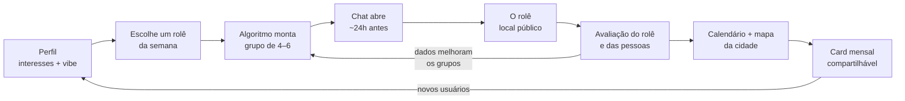

# 01 · Visão do Produto

> Status: 🟡 Rascunho v2 — conceito "rolê com gente nova + identidade de rolê". Itens marcados com **(validar)** dependem do cliente.

## Em uma frase

**Guide.app: rolês na sua cidade com pessoas que combinam com você — e cada rolê vira parte da sua história.**

A recomendação de eventos continua existindo, mas é **o meio**. O produto é **ir junto**.

## O problema

Quem quer viver a cidade e conhecer gente nova enfrenta:

- **Ninguém para ir junto**: recém-chegados, amigos com agendas diferentes, vontade de sair da bolha.
- **Informação espalhada e genérica**: Instagram, Sympla, grupos de WhatsApp. As plataformas de ingresso mostram o que vende mais, não o que combina com a pessoa.
- **Conhecer gente em app de relacionamento cansa**: o encontro um a um tem pressão; muita gente quer amizade e turma, não date.

## Por que não "só mais um app de eventos"

A pesquisa de mercado (nov/2026) mostrou:

| Achado | Implicação |
|--------|------------|
| Sympla, Fever e Ticketmaster já oferecem descoberta por cidade e personalização. | Recomendação por perfil, sozinha, é fácil de copiar. |
| Apps de "só descoberta" historicamente morrem: falta de eventos e usuários no início, nenhuma venda dentro do app, troca de app sem custo. | Precisamos de transação própria e de algo que prenda o usuário. |
| No Brasil, a descoberta acontece no Instagram e por indicação de pessoas. | A confiança vem de gente, não de algoritmo. |
| Timeleft (jantar com 5 desconhecidos) está em 6 cidades brasileiras e no top 15 de Eventos no Brasil. | **Pessoas pagam para conhecer gente nova.** |
| Partiful: ver *quem vai* convence quem está indeciso. | O "com quem" pesa mais que o "o quê". |

**Diferencial do Guide.app:** usar o perfil de personalidade para montar **grupos compatíveis que vão juntos a rolês da cidade** (festa, show, cultura), e transformar o histórico desses rolês em **identidade compartilhável**. Não é jantar (Timeleft), não é ingresso (Sympla/Fever): é **turma para o rolê**.

## Para quem (público-alvo)

| Critério | MVP | Observação |
|----------|-----|------------|
| Idade | **18+ obrigatório**, foco 18–35 | Encontro entre desconhecidos: menores fora, sem exceção. |
| Classe | Média e alta | Disposição para pagar pela experiência. |
| Geografia | **Uma cidade** | Concentrar usuários para conseguir fechar grupos. **(validar qual)** |
| Comportamento | Recém-chegados na cidade; quem quer sair da bolha; quem sai com frequência mas sem turma fixa | |

## Como funciona — o ciclo

1. **Perfil** — interesses (categorias) + vibe. Serve para escolher eventos **e** pessoas.
2. **Escolha** — o usuário entra em um rolê da semana. *(Logo após o lançamento: "me surpreenda", RF-17.)*
3. **Grupo** — o algoritmo forma grupos de 4–6 pessoas compatíveis.
4. **Aquecimento** — chat do grupo abre ~24h antes. *(Logo após o lançamento: a IA sugere um quebra-gelo com base no que o grupo tem em comum, RF-26.)*
5. **O rolê** — encontro em local público, normalmente o próprio evento.
6. **Depois** — avaliação rápida, opção de manter contato, "fui" registrado automaticamente.
7. **Identidade** — o rolê entra no calendário e no mapa da cidade; todo mês sai um card pronto para o Instagram, que traz novos usuários.

## O perfil: dois eixos

| Eixo | Exemplos | Uso |
|------|----------|-----|
| **Interesses** (categorias) | Festas, Shows, Locais Culturais, Gastronomia, Carnaval/Sazonais, Ar livre | Quais rolês sugerir |
| **Vibe** (tags) | Tranquilo ↔ Agitado · Faixa de preço · Introvertido ↔ Extrovertido · Dias/horários | Com quem montar o grupo |

## Liquidez: rolês curados em dia fixo

O que faz o Timeleft funcionar não é o algoritmo, é o **ritual**: toda quarta, mesmo formato. Isso concentra as pessoas no mesmo dia e garante que os grupos fechem.

Se o usuário puder escolher qualquer evento, a cidade se espalha e nenhum grupo fecha. **No MVP: 2–3 rolês curados por semana, em dias fixos** (ex.: *quinta de cultura*, *sábado de festa*), em parceria com casas e produtores. Escolher qualquer evento só quando houver volume. **(validar)**

## A IA — em fases

| Fase | O que faz | Por quê |
|------|-----------|---------|
| **MVP** | **Montagem de grupos**: maximizar compatibilidade de vibe e interesses dentro de cada grupo, respeitando preferências (ex.: grupo só de mulheres). | É o coração do produto e o que os concorrentes de ingresso não têm. |
| **MVP** | Pontuação de rolês por perfil (interesses + vibe + data). | Ordena os rolês da semana para cada pessoa. |
| **Pós-lançamento (P1)** | LLM para o quebra-gelo do grupo (RF-26) e, opcionalmente, onboarding conversacional ("me conta o que você curte"). | Diferencial visível e barato. Duas personas pedem o quebra-gelo; a prioridade está em aberto com o cliente. |
| **MVP** | **Registrar tudo**: avaliações pós-rolê, quem manteve contato, no-shows, cliques. | É o dado exclusivo que treina a fase 2. |
| **Fase 2** | Aprender com as avaliações quais combinações de pessoas funcionam; embeddings com pgvector. | Depende de volume de rolês realizados. |

## Escopo do MVP

### Entra ✅

- Cadastro com **verificação de identidade** (selfie + documento) e bloqueio de menores de 18
- Onboarding: interesses + vibe
- Lista dos rolês da semana, ordenada por perfil
- Inscrição e pagamento por rolê
- Montagem automática de grupos de 4–6 pessoas
- Preferência de grupo "só mulheres"
- Chat do grupo (abre ~24h antes, fecha após o rolê)
- Avaliação pós-rolê (rolê e participantes) e opção de manter contato
- Denúncia, bloqueio e banimento
- Taxa de no-show reportada pelo grupo
- Calendário + mapa da cidade com os rolês feitos
- Card mensal compartilhável
- Painel administrativo: cadastrar rolês, acompanhar inscrições, moderar denúncias

### Fica fora (fase 2+) ❌

- Escolher qualquer evento da cidade (não curado)
- Venda de ingresso do evento dentro do app (MVP: ingresso via parceiro ou incluso no rolê)
- Conquistas, estatísticas avançadas, retrospectiva anual
- Painel self-service para produtores
- App nativo nas lojas (MVP é PWA)
- Múltiplas cidades
- Reels, filmes em cartaz, avaliações por IA (existiam no protótipo original)

## Modelo de negócio **(validar)**

| Fonte | Quando | Nota |
|-------|--------|------|
| **Pagamento por rolê** | MVP | Valida se as pessoas pagam. |
| **Comissão / parceria com casas e produtores** | MVP | O grupo leva público garantido à casa. |
| Assinatura | Fase 2 | Timeleft migrou para assinatura depois de ganhar escala. |

## Métricas de sucesso do MVP **(validar metas)**

- % de grupos que fecham (inscritos suficientes por rolê)
- Taxa de comparecimento (1 − no-show)
- Nota média do rolê e do grupo
- % de pessoas que **voltam para um segundo rolê** em até 30 dias (métrica principal)
- % de cards mensais compartilhados

## Riscos

| Risco | Mitigação |
|-------|-----------|
| **Segurança** (um incidente grave pode matar o app) | Verificação de identidade, 18+, só locais públicos, grupos só de mulheres, denúncia e banimento, termos claros. Detalhes em [Segurança do usuário](seguranca.md). |
| **A verificação afastar quem tem medo** (ver persona [Bruno](ux/personas.pptx)) | Explicar em linguagem simples o que é coletado, por quem e por quanto tempo; guardar só o resultado da verificação, não o documento **(validar com fornecedor e advogado)** |
| **Verificação não impede má intenção** | Verificar prova *quem* a pessoa é, não *o que ela pretende*. Regras de grupo, reputação e resposta rápida a denúncias reduzem o risco, mas não o eliminam |
| **Grupos não fecham** | Cidade única, poucos rolês em dias fixos, meta mínima de inscritos antes de confirmar |
| **No-show** | Pagamento antecipado + taxa de no-show + reputação |
| **Timeleft expandir para além do jantar** | Foco local e em rolê (festa, show, cultura), parcerias com casas da cidade |
| **Operação pesada** (curadoria, parcerias, moderação) | Prever pessoas no time, não só desenvolvimento |
| **LGPD** (documento, selfie, localização) | Consentimento explícito, dados sensíveis criptografados, exclusão de conta e dados |

## Stack proposta

| Camada | Tecnologia | Nota |
|--------|------------|------|
| Front-end | React + Vite + Tailwind, como **PWA** | Público mobile; evita App Store no MVP. |
| Back-end | Java + Spring Boot, **monólito modular** | Módulos: conta, rolê, pagamento, grupo, chat, avaliação, identidade, moderação. |
| Banco | PostgreSQL + **PostGIS** (Docker) | Mapa da cidade e locais. pgvector na fase 2. |
| Tempo real | WebSocket (Spring) | Chat do grupo. |
| Infra local | Docker Compose | Tudo sobe com um comando. |

## Fontes da pesquisa

- [Timeleft – Similarweb Brasil](https://www.similarweb.com/app/google/com.timeleft.app/brazil) · [Timeleft – App Store](https://apps.apple.com/app/timeleft/id6466442949) · [Timeleft – no-show](https://help.timeleft.com/hc/en-150/articles/25012703925148-What-Is-the-No-Show-Penalty-Fee) · [Timeleft – só assinatura](https://help.timeleft.com/hc/en-150/articles/17677297227164-Subscription-Only-Experience)
- [Sympla – App Store](https://apps.apple.com/BR/app/id1136318924) · [Fever – App Store](https://apps.apple.com/BR/app/id497702817) · [Ticketmaster – personalização](https://business.ticketmaster.com.au/?p=62827)
- [Partiful – Sacra](https://sacra.com/chat/h/d75d313a-21c0-4696-ae31-3ccb39d25c1c/)
- [Descoberta sem transação](https://vik-website.web.app/notes/byte-bites/startup-failures/discovery-without-transactions.html) · [EventVue – Failory](https://www.failory.com/cemetery/eventvue)
- [Jovens e Instagram – ABC da Comunicação](https://www.abcdacomunicacao.com.br/instagram-a-nova-fonte-de-informacao-dos-jovens/)
