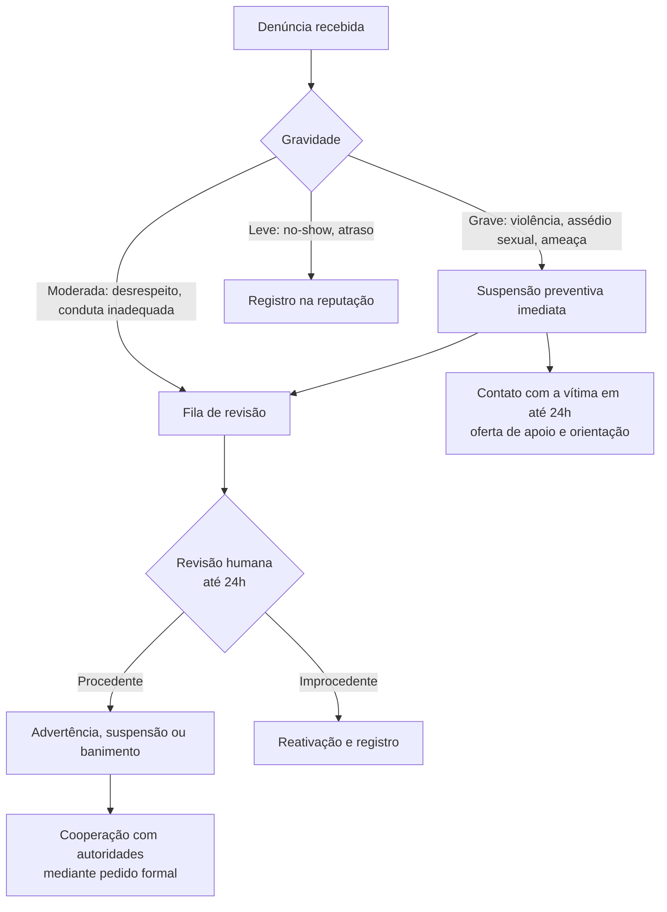

# Segurança do Usuário (Trust & Safety)

> Status: 🟡 Rascunho. Itens jurídicos marcados com **(advogado)** precisam de validação legal antes do lançamento.

## Princípio

"Nenhum incidente" não é uma promessa possível. O objetivo é:

1. **Reduzir a probabilidade** — barrar e afastar quem oferece risco.
2. **Reduzir o impacto** — desenhar o produto para que, se algo der errado, o dano seja menor.
3. **Responder rápido e bem** — protocolo definido antes do lançamento.

Segurança faz parte do design do produto, não é uma tela de termos. E é argumento de venda: **"todo mundo aqui é verificado"**.

## Prioridade

- **P0 — obrigatório no lançamento.** Sem isso o MVP não vai ao ar.
- **P1 — logo após o lançamento.**

## Camada 1 · Quem entra

| ID | Medida | Prior. |
|----|--------|--------|
| SEG-01 | Verificação de identidade: documento + selfie com prova de vida, via fornecedor brasileiro (ex.: unico, idwall, CAF). | P0 |
| SEG-02 | Idade mínima de 18 anos confirmada pelo documento. | P0 |
| SEG-03 | Uma conta por CPF; telefone verificado. | P0 |
| SEG-04 | Banimento por CPF e biometria, impedindo nova conta. | P0 |
| SEG-05 | Código de conduta aceito ativamente no cadastro (tela própria, 3–4 regras claras). | P0 |

## Camada 2 · Montagem do grupo

O algoritmo de grupos é a ferramenta de segurança mais forte que temos.

| ID | Medida | Prior. |
|----|--------|--------|
| SEG-10 | Grupos com no mínimo 4 pessoas. Nunca encontro a dois. | P0 |
| SEG-11 | Equilíbrio de gênero: nunca uma mulher sozinha num grupo de homens. | P0 |
| SEG-12 | Opção de grupo só de mulheres. | P0 |
| SEG-13 | Usuários que se bloquearam nunca caem no mesmo grupo. | P0 |
| SEG-14 | Usuários novos começam por rolês de risco baixo (ex.: exposição, show no início da noite); festa de madrugada só após avaliações positivas. | P1 |
| SEG-15 | Reputação influencia a montagem: quem recebeu alertas não é colocado com usuários novos ou em grupos vulneráveis. | P1 |

## Camada 3 · Privacidade antes do encontro

| ID | Medida | Prior. |
|----|--------|--------|
| SEG-20 | No grupo, só aparecem primeiro nome, foto e interesses. Sobrenome, telefone e redes sociais ficam ocultos. | P0 |
| SEG-21 | Troca de contato só com aceite dos dois lados ("quero manter contato") após o rolê. | P0 |
| SEG-22 | Chat apenas dentro do app; abre ~24h antes e fecha após o rolê. | P0 |
| SEG-23 | Endereço exato visível só para membros do grupo. Sem localização em tempo real. | P0 |
| SEG-24 | Moderação do chat por IA: assédio, insistência para sair do app, pedido de dados pessoais. | P1 |

## Camada 4 · Durante o rolê

| ID | Medida | Prior. |
|----|--------|--------|
| SEG-30 | Rolês só em locais públicos, preferencialmente casas parceiras com ponto de contato da equipe do local. | P0 |
| SEG-31 | Botão "saí do rolê": sair a qualquer momento, sem justificativa e sem penalidade. | P0 |
| SEG-32 | Botão de ajuda com atalho para 190 e Ligue 180, e denúncia rápida. | P0 |
| SEG-33 | "Compartilhar meu rolê" com contato de confiança (onde, quando, com quem). | P1 |
| SEG-34 | Lembretes de segurança no dia: transporte próprio, atenção à bebida. | P1 |

## Camada 5 · Depois do rolê e resposta a incidentes

| ID | Medida | Prior. |
|----|--------|--------|
| SEG-40 | Avaliação privada de cada participante com a pergunta "você se sentiu seguro(a)?". Alerta silencioso pesa mais que nota. | P0 |
| SEG-41 | Denúncia possível a qualquer momento, inclusive dias depois do rolê. | P0 |
| SEG-42 | Denúncia grave gera suspensão preventiva imediata do denunciado. | P0 |
| SEG-43 | Revisão humana de denúncias em até 24h. | P0 |
| SEG-44 | Identidade de quem denuncia nunca é exposta. | P0 |
| SEG-45 | Painel de moderação para o admin: denúncias, histórico do usuário, ações (advertir, suspender, banir). | P0 |

## Limites e pontos de atenção

A persona [Bruno](02-personas.md) (vítima de golpe após um encontro marcado por app) mostra o que estas camadas **não** resolvem:

- **Verificar não é o mesmo que confiar.** A verificação prova *quem* a pessoa é, não *o que ela pretende*. Reputação e denúncia só agem depois do primeiro incidente.
- **A própria verificação pode afastar quem tem medo.** Pedir documento e selfie assusta quem já teve dados vazados. Candidatas a medida **(validar com fornecedor e advogado)**:
  - explicar, antes do envio, o que é coletado, quem processa, onde fica e por quanto tempo ([US-11](02-user-stories.md#us-11));
  - guardar no app só o resultado da verificação, e não o documento nem a selfie.
- **O que acontece dentro do local foge do app.** Golpe com bebida ("boa noite, Cinderela") e furto acontecem no ambiente físico. Parcerias com as casas e orientação (SEG-30, SEG-34) reduzem o risco, mas não o eliminam.
- **Ir com alguém de confiança** é um pedido forte de quem tem medo ([US-12](02-user-stories.md#us-12)), mas ainda não existe e mexe nas regras de grupo da Camada 2.

## Protocolo de incidente (rascunho)

## Organização

- **Responsável por Trust & Safety desde o primeiro dia.** Não precisa ser dedicação exclusiva, mas precisa ter nome e substituto.
- Playbook de incidente escrito e revisado antes do lançamento.
- Métricas acompanhadas semanalmente: % de rolês com alerta, tempo até a primeira resposta, reincidência.

## Jurídico e LGPD **(advogado)**

- **Biometria é dado sensível (LGPD).** Exige consentimento específico, criptografia, retenção mínima e encarregado de dados (DPO) definido.
- **Checagem de antecedentes criminais**: avaliar viabilidade legal e risco de discriminação antes de adotar.
- **Termos de uso**: o app intermedia o encontro, não o organiza; política de banimento; limites de responsabilidade.
- **Guarda de registros** (chat, denúncias) por prazo definido, para cooperar com autoridades sem reter dados além do necessário.
